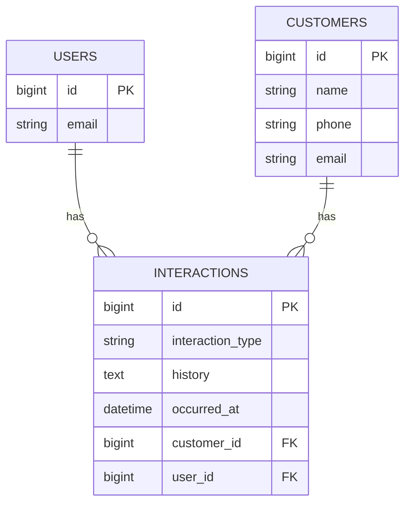
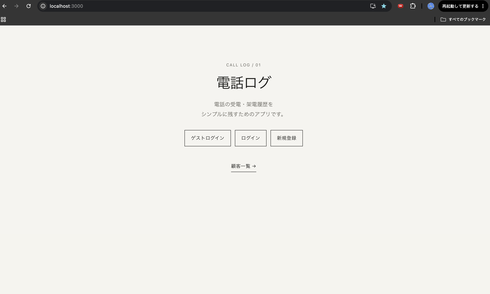
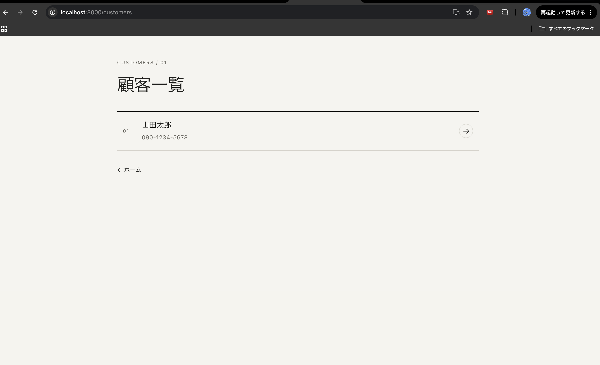
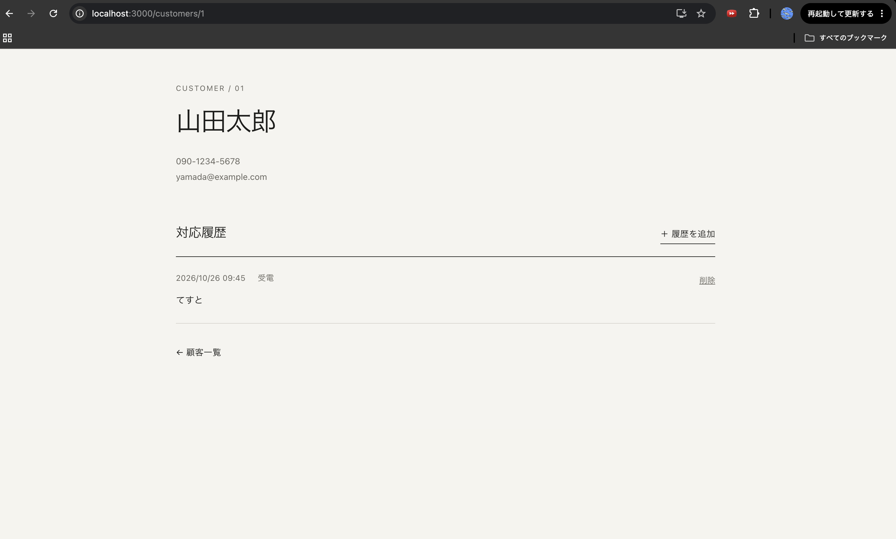

# Support Log

## アプリ概要

電話・問い合わせ対応の履歴を記録・管理するWebアプリです。

顧客ごとに「受電・架電」の対応区分、会話・対応内容、対応日時を記録できます。

## 開発背景

電話や問い合わせ対応では、対応した内容を後から確認したり、過去の対応履歴を参照したりする必要があります。

そこで、顧客ごとの対応履歴を簡単に記録・確認できるシンプルな管理アプリを作成しました。

## 主な機能

- ユーザー登録・ログイン
- ゲストログイン
- 顧客一覧・詳細表示
- 対応履歴の登録
- 受電・架電の区分
- 会話・対応履歴の記録
- 対応日時の記録
- 対応履歴の削除

## 使用技術

- Ruby
- Ruby on Rails
- PostgreSQL
- Devise
- HTML / CSS
- Git / GitHub

## 使い方

1. ユーザー登録またはログインします。
2. 顧客一覧から顧客を選択します。
3. 「履歴を追加」から対応内容を登録します。
4. 登録した対応履歴を顧客詳細画面から確認できます。
5. 不要な履歴は削除できます。

## ER図

## 工夫した点

- 顧客と対応履歴を紐付け、顧客ごとに過去の対応内容を確認できるようにしました。
- 受電・架電を区別して記録できるようにしました。
- 必要な機能に絞り、シンプルで操作方法が分かりやすい構成にしました。
## アプリのスクリーンショット

### トップ・ログイン画面

### 顧客一覧

### 顧客詳細・対応履歴

